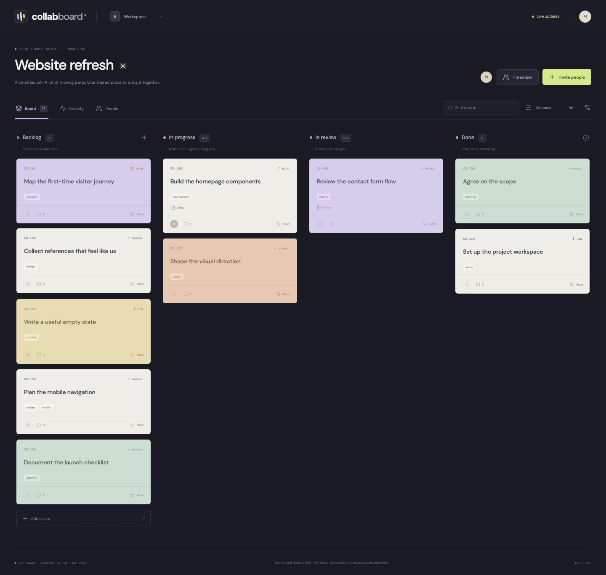

# CollabBoard

**A shared Kanban workspace for tasks, conversations and moving work forward.**

[](https://collabboard-demo.onrender.com/)
[](https://github.com/mileevskiyy/CollabBoard/actions/workflows/ci.yml)

**[Open the live demo](https://collabboard-demo.onrender.com/)** → **Try the demo**. No account or setup key required. To test with another identity, create an invitation and open it in a private browser window. The free service may take a little time to wake after inactivity.

CollabBoard gives a small group one place to organize a project: create cards, assign work, discuss decisions and move tasks through Backlog, In progress, In review and Done. Changes arrive in other browser sessions through a live event stream. The visual direction pairs a graphite workspace with coloured cards, condensed display typography and restrained lime accents.



## Try it with someone

1. Enter a display name and select **Try the demo**. This creates your own private sample board.
2. Select **Invite people**, choose Editor or Viewer and create a link.
3. Copy the link and share it with **one person**, or open it in a private/incognito window to test another identity.
4. Your collaborator enters a name and joins. A normal second tab uses the same cookie and identity; use a separate browser profile or private window to test another person.
5. Create or move a card and watch the other session update without a page refresh.
6. Open a card to edit its details or add a comment. The owner can change roles and remove members from **People**.

Each invitation is single-use and expires after one hour or when the board expires, whichever comes first. Generate a separate link for each person. The raw link is returned only at creation; the server stores its hash. A used or lost link cannot be recovered from the server. Revoking an unused invite prevents a future join; removing an existing member is a separate action.

## Implemented features

- Four fixed columns with drag-and-drop ordering and an explicit **Move** control for keyboard/touch use.
- Card titles, descriptions, tags, priority, colour, member assignment and UTC due dates.
- Search and filters for personal assignments, unassigned work and high-priority cards.
- Comments with server-attributed demo identity; authors can remove their comments, and owners can moderate.
- Owner, Editor and Viewer roles enforced on API reads, writes and live subscriptions.
- One-time invitations, member role changes and immediate removal from live access.
- Configurable work-in-progress limits for In progress and In review.
- A bounded activity timeline containing actual changes rather than fictional historical usage.
- Live invalidation, reconnect revision replay and resynchronization after activity retention gaps.
- Multiple boards per anonymous demo identity.

The ten initial cards describe an illustrative website-refresh project. Only the actual creator is a member initially; no fictional teammates or review history are inserted.

## Permissions

| Capability                                 | Owner | Editor | Viewer |
| ------------------------------------------ | ----- | ------ | ------ |
| Read cards, comments, activity and members | Yes   | Yes    | Yes    |
| Create, edit, move and remove cards        | Yes   | Yes    | No     |
| Add comments / remove own comments         | Yes   | Yes    | No     |
| Remove another author's comments           | Yes   | No     | No     |
| Create/revoke invitations                  | Yes   | No     | No     |
| Change roles or remove members             | Yes   | No     | No     |
| Change board details and WIP limits        | Yes   | No     | No     |

The owner cannot be removed or demoted. Removing an assignee clears their assignments and advances the affected card versions. Old comments and activity retain their original display-name attribution. Names are anonymous demo labels, not verified identities or authenticated real-world accounts.

## Consistent collaboration

### Card versions prevent lost updates

An edit or move carries the card version it was based on. If another session changes the card first, the stale request returns `409` instead of replacing newer work. The open editor keeps its local draft and offers **Load latest** explicitly. Updates to different cards do not require a shared global board revision, and adding a comment does not invalidate a card-content draft.

Administrative settings use a captured board revision. A stale settings form cannot silently overwrite newer board metadata. The browser also ignores an older snapshot arriving after a newer one and drops refreshes belonging to a board it has already left.

### Each keyed mutation is atomic

A SQLite transaction validates membership, role, version, references and capacity before committing the card change, activity event, board revision and request receipt together. A repeated request ID with the same actor/action/payload returns a replay without applying the action again. Reusing it for different content conflicts.

The browser retains a pending request key after a network or server failure, so retrying the same in-memory operation can reuse it. This is not a durable offline queue: a full browser restart clears pending client state. New session/board creation is not covered by the board mutation receipt system.

### Work-in-progress limits are real constraints

A move into a limited column checks its current occupancy inside the transaction. Two clients competing for the last slot cannot both fill it. Reordering within a full column remains allowed because the moving card does not consume another slot. Positions are normalized to dense integers; no floating-point ranks are accumulated.

A drop may target a card in the destination column or append to its end. A stale/deleted drop target produces a conflict rather than an arbitrary placement. Reducing a WIP limit below current occupancy is rejected. `0` means unlimited.

## Live update model

Commands use ordinary HTTP. The server sends **Server-Sent Events (SSE)** as small revision invalidations; clients then fetch the current authorized snapshot. This is a one-way event stream, not WebSockets or collaborative text merging.

- A new connection announces the current revision, catching changes between initial load and subscription.
- On reconnection, `Last-Event-ID` can replay retained change revisions.
- If the cursor is older than the latest 200 activity entries, the server requests a full resync.
- The client coalesces bursts of invalidations and keeps the newest snapshot.
- A 15-second heartbeat keeps the connection active and checks expiry/access again.
- Member removal closes that member's existing streams immediately after commit. Future reads and writes also fail.

The live indicator describes the connection, not whether every member is online. Delivery is not claimed to be exactly once; revision refresh and idempotent commands address duplicate notifications and retries separately.

## Architecture

```text
React board / card editor / people / activity
                      |
            HTTP commands + CSRF
                      |
Express -> session -> membership -> role -> version / WIP checks
                      |
        atomic SQLite workspace aggregate
          cards + comments + events + receipts
                      |
             publish after commit
                      |
        SSE revision hint -> authorized snapshot fetch
```

| Layer          | Implementation                                                           |
| -------------- | ------------------------------------------------------------------------ |
| Client         | React 19, TypeScript, CSS, Lucide icons                                  |
| Build          | Vite 6                                                                   |
| API            | Node.js 24, Express 5, Zod 4                                             |
| Persistence    | Built-in `node:sqlite`                                                   |
| Live transport | Native EventSource / SSE                                                 |
| Verification   | Node test runner, HTTP/SSE integration tests, Playwright, GitHub Actions |
| Packaging      | Docker, one web service                                                  |

The SQLite schema separates sessions, board aggregates and invitation hashes. Board writes are synchronous and transactional within one Node process. Live connections and admission limits are process-local. No external queue, cache, identity provider or managed database is required for the demo.

Fonts use DM Sans, Barlow Condensed and Space Mono from Google Fonts when available, with local sans-serif and monospace fallbacks.

## Demo lifetime and bounds

The public service uses an in-memory database. Restarting it clears sessions, boards and invitations. A board has a fixed **24-hour lifetime from creation**, even if someone continues working. A session expires after 24 hours of inactivity. Optional file storage survives restarts but retains these expiry rules. Keep the original browser cookie to retain your anonymous identity.

Expired data becomes inaccessible immediately; cleanup runs when new sessions or boards are created. A random HttpOnly, SameSite=Strict cookie identifies a session; its digest is stored. Mutations require CSRF, browser Origin headers are checked, hosted cookies use Secure, and links use a no-referrer policy. User text is rendered as React text rather than injected HTML.

Limits: 100 boards; 500 sessions; 8 board memberships per session; 12 members and 120 cards per board; 50 comments per card and 500 per board; 20 active unused invites per board; 2,000 keyed mutations before a fresh demo board is needed. Activity retains 200 entries while request receipts remain until board expiry. Serialized board payloads are capped at 1.5 MiB each and 48 MiB combined. Live streams are capped at 80 per process and four per session. JSON request bodies are capped at 64 KB, and session creation is rate-limited.

These are operating bounds, not measured production capacity. The project has no durable accounts, account recovery, end-to-end encryption, CRDT editing, notifications, attachments or cross-server coordination.

## Run locally

Requires Node.js 24.

```sh
npm ci
npm run build
npm start
```

Open `http://127.0.0.1:3700`. No setup key is needed. To try collaboration, copy an invitation into a private browser window.

For optional local persistence, copy `.env.example` to `.env` and set `DATABASE_PATH=./data/collabboard.sqlite`. Runtime data and `.env` are ignored by Git. For frontend development, run `npm run dev:api` and `npm run dev` in separate terminals, then open port `3701`.

## Verify

```sh
npm test
npm run build
npm run test:e2e
```

Tests cover membership and role isolation, invite consumption/revocation, replay protection, stale edits, WIP capacity, ordering, comments, forced rollback, expiry, file persistence and real SSE connections. Browser scenarios use independent editor/viewer sessions and exercise actual drag-and-drop.

See [architecture and API](docs/ARCHITECTURE.md), [verification](docs/VERIFICATION.md), [CV/LinkedIn wording](docs/PORTFOLIO.md), [GitHub and demo guide in Russian](docs/GITHUB_UPLOAD_RU.md) and [future work](docs/ROADMAP.md).

## Deploy

Build the Dockerfile and expose the platform `PORT` on `HOST=0.0.0.0`. Set `COOKIE_SECURE=true` and a full HTTPS `APP_ORIGIN`, or use Render's injected `RENDER_EXTERNAL_URL`. Keep `DATABASE_PATH=:memory:` for a disposable public demo. Health is exposed at `/api/health`.

Use one server process. A multi-process deployment would need shared event fan-out and coordinated admission control. SSE responses disable buffering/caching, send heartbeats and close during graceful shutdown. Free hosting may sleep between visits; the first visit can take longer. If the server restarts, open a fresh demo because the old in-memory board and session no longer exist.
